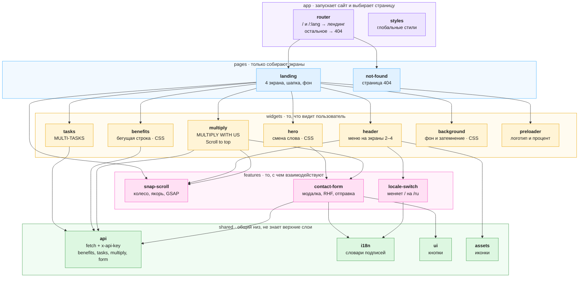

src/
│
├── app/
│ ├── router.tsx / и /:lang открывают одну страницу, неизвестный путь - 404
│ └── styles/ глобальные стили
│
├── pages/
│ ├── landing/ собирает виджеты и использует скролл
│ └── not-found/ страница с 404
│
├── widgets/
│ ├── header/ меню с лого
│ ├── hero/ первый экран и смена слова
│ ├── tasks/ MULTI-TASKS
│ ├── benefits/ MULTI-BENEFITS и бегущая строка
│ ├── multiply/ MULTIPLY WITH US и Scroll to top
│ ├── background/ живой фон и затемнение на втором экране
│ └── preloader/ комбинированный прелоадер
│
├── features/
│ ├── snap-scroll/ колесо, якорь, направление, GSAP
│ ├── contact-form/ модалка, валидация, отправка, окно благодарности
│ └── locale-switch/ кнопка смены языка, меняет адрес
│
└── shared/
├── api/ обёртка над fetch, benefits, tasks, multiply, POST /form
├── i18n/ словари подписей, которых нет в API
├── ui/ кнопки
└── assets/ иконки

## Архитектура (лёгкий FSD)

Стрелка значит «использует». Слой берёт только то, что ниже него. `shared` не знает ни один верхний слой.

| Слой       | Зачем                               | Что лежит                          |
| ---------- | ----------------------------------- | ---------------------------------- |
| `app`      | Запустить сайт и выбрать страницу   | Роутер, глобальные стили           |
| `pages`    | Собрать экраны в одну страницу      | Лендинг, 404                       |
| `widgets`  | Показать то, что видит пользователь | 4 экрана, шапка, фон, прелоадер    |
| `features` | Обработать действие пользователя    | Перелистывание, форма, смена языка |
| `shared`   | Дать общее всем слоям выше          | Запросы, словарь, кнопки, иконки   |

Языки не отдельные страницы: тот же лендинг открывается на `/` и `/ru`. Номер экрана в адрес не входит, его держит `snap-scroll` и читает якорь, например `#join`.
